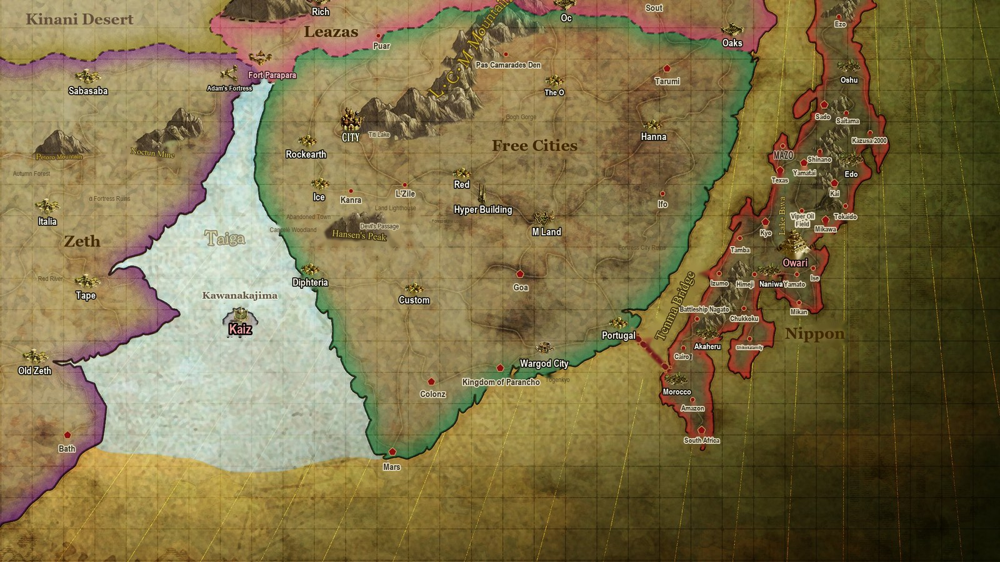

# Rance X -Showdown- English Translation

An unofficial, complete English translation patch for **Rance X -Showdown-** (ランス１０ -決戦-, AliceSoft), the
Japanese PC version 1.04.

- **The whole story retranslated from the Japanese**: about 270,000 lines, scene by scene, with every character's
  voice modelled on MangaGamer's official English releases of the earlier Rance games.
- **Images re-lettered**: the title screen, 69 story maps and the strategy-screen maps, all 40 Nunuhara memos, all
  11 help screens and about 50 interface images, plus the animated captions.
- **Opening movie in English**: the Part 1 opening's typed narration and its name cards.
- **Interface and data**: menus, battle logs, cards, character profiles, CG and music titles, achievements.
- **One installer** for the plain Japanese game. No other patch needed, it also installs over klesun's machine
  translation or an older version of this patch.

> [!NOTE]
> Rance X is an adult (18+) game. This is a fan project, not affiliated with AliceSoft or MangaGamer. It contains no
> game files: you need your own copy of the Japanese game. Please support the official release.

**[Download v2.0.5](https://github.com/narwalstonesun/rance10-english/releases/download/v2.0.5/Rance10-English-Revision-v2.0.5.zip)**
· [Installation guide](#installation-guide) · [Dialogue comparisons](docs/COMPARISONS.md) ·
[Image comparisons](docs/IMAGES.md) · [How it was made](docs/METHOD.md) · [Changelog](CHANGELOG.md) ·
[Report a problem](../../issues/new/choose)

## Before and after

**A regional map** (the Free Cities and Nippon, 82 labels), Japanese original:

This patch:

**The same screen in three versions** (Japanese 1.04 | klesun MTL | this patch), a battle:

More: 3-way comparisons of the turn map, quest map and a text box, the title screen, the world map, Nunuhara memos, help screens and interface in **[Image comparisons](docs/IMAGES.md)**.

**Story text**: the briefing in the Prologue. The machine translation this project started from was done line by
line, and in places its lines drifted out of step with the script. 

*Author note:* I asked the AI to come up with the best comparison and this is what it came up with

| Speaker | Japanese | Previous fan patch (klesun MTL) | This patch |
|---|---|---|---|
| Rance | 「そうだ、いい加減に説明しろ説明」 | In that case, we have no choice but to rely on the local defense garrisons... | "Yeah, enough already, explain." |
| Crook | 「では、私の口から説明させて頂きます」 | "Then, allow me to explain from my side." | "Then, allow me to explain." |
| Crook | 「今、人類国家は滅亡の危機に瀕しています」 | "Right now, the human nations are facing the brink of extinction." | "Right now, the nations of humanity are facing the threat of extinction." |
| Rance | 「…………何故だ？」 | Whatever happens, we must hold and defend Rance Castle | "......Why?" |
| Crook | 「LP7年9月17日、今から二週間ほど前、 魔人ケイブリス率いる魔軍の大軍団が 攻めてきました」 | until the summit meeting concludes. a massive Monster Army led by the Fiend lord Kayblis attacked." | "On September 17th, LP7, about two weeks ago, a huge Monster Army force led by the Fiend Kayblis attacked." |
| Crook | 「地図をご覧下さい」 | Indeed. This summit is of paramount importance | "Please look at the map." |
| Crook | 「リーザス、ゼス、ヘルマン、自由都市、 ランスもご存じの四つの大国が同時に攻め込まれました」 | for the future of humanity. which even Rance knows of - were attacked simultaneously." | "Leazas, Zeth, Helman, the Free Cities... The four great nations you know, Rance, were invaded at the same time." |

More examples (shifted lines, Rance's voice, dialects, honorifics, names), all from the Prologue, in
**[Dialogue comparisons](docs/COMPARISONS.md)**.

## From the author

*This section is my own words. Everything else in this README was written by Claude.*

Yo, I got tired of waiting for the Rance X translation. Its been at 85% editing for like half a year now, and now they
even got rid of the status on the MangaGamer page. I recently got into Claude and had it do some translations for a
few Korean webnovels and I was quite happy with the translations it made. So I wondered if it could do Rance X well enough, 
this is my attempt at it.

This started off from the translation already done by klesun (https://github.com/klesun/rance-10-gpt-mtl), but the
whole story has now been retranslated from the Japanese, and you don't need klesun's patch to install this. I
used Claude to translate anything it can, and for stuff it can't translate I used an uncensored/abliterated DeepSeek
V4.1 Flash model hosted by Venice. Its the best I know of currently. Generally text translated by Claude is done
using Sonnet, but most other work is done using Opus.

For the method of translation, I am trying to do better than the previous machine translation method of sentence by
sentence, where instead the models get a ton of relevant context about the scene or characters before doing the
translation. This seems to fix a lot of quality problems. In particular, I got Claude to read the dialogue from the
previous games in the series already translated by MangaGamer to build these speech and character profiles.
Generally it worked well, to me at least the quality is very playable. There are some problems though, like
sometimes I feel like the model leans too much into Rance's oddities with his method of speaking. This is specially
relevant with anything translated by the DeepSeek model, which, for obvious reasons due it being a smaller and weaker
model, makes worse translations.

The other big part of the work is that Claude was able to do a ton of OCR, so the game map and other image based text
is translated too. Some of the image text (like the in-game calendar) is also used by the game as data, which is why
the earlier translations didn't touch it, I got Claude to have a go at making sure this problem doesn't happen, it 
says how it did it in the Method document. I am still testing though so problems or bugs may exist.

If someone actually uses this, and finds a problem please create a github issue. I'll try get around to it. If you
have any issues that aren't related to bugs or game problems, also feel free to open an issue anyways, just label it
appropriately. These issues can be "vibes" based as well, like "This character feels like it was translated poorly",
or "this scene feels too AI". Just make sure you give me some information to go off of and keep the issues themselves
spoiler free if possible (idk how possible this request is).

I haven't actually played or finished the game yet so please no spoilers :D. Playing through it now and fixing
stuff I stumble across along the way. I haven't ever interacted with the fan translation community as a whole so I 
don't really know what to expect after posting this. Also, I don't know Japanese at all.

## What's translated

| Part | What this patch does |
|---|---|
| Story | All ~270,000 story lines translated from the Japanese: Prologue, Part 1, Part 2, After mode, character events, the Nunuhara memo text and Synopsis Mode. About 236,000 lines by Claude; about 33,500 lines (adult scenes Claude doesn't translate) by the uncensored/abliterated version of DeepSeek V4.1 Flash through Venice AI, with the same names, terms and character notes. |
| Names and terms | Character names and terms follow the [AliceSoft Wiki](https://alicesoft.miraheze.org) and the official English releases ("Master Rance", "Monster Army", "Fiend"); game-system terms (EXP, Meal Ticket, Unit Bonus, Buff/Debuff, statuses) are the same in the story, the interface and the images. |
| Images | Title logo and title-screen map; 69 story maps (world, regional, Monster Realm, campaign maps with name tags) and the strategy-screen maps (turn map, War Situation panels, war-status screen, quest maps); 40 Nunuhara memos and their list thumbnails; 11 help screens; about 50 interface images (war-status maps, stamps, Unit Bonus / Unit Rank, EXP labels, collection tabs, ending credits); animated captions ("Meanwhile", war results, battle end, "Get!", phase titles). |
| Interface | About 1,400 interface and script strings (speaker names, choices, battle logs, dialogs, enemy hints), English number formatting (35,000 instead of 3万5千), status names, card names on item cards, a message font size that fits English. |
| Data tables | CG gallery and music titles, place names, achievements, all 4,414 character profile lines. |
| Movies | The typed narration of the Part 1 opening movie and its name cards / nation banners, re-lettered with the original motion. |

**What stays in Japanese**: text painted into the scenery (shop signs, banners), as in the official English
releases; comments inside saves made before installing; the ending movie (staff roll). Text inside event CGs has not been checked.

## Installation guide

You need the Japanese PC version of Rance X on Windows and about 6 GB of free disk space while installing (the zip, its extracted files and the backup). It takes
about 10 minutes, most of it downloading.

### Step 1 - Find your game folder
The default location is `C:\Program Files (x86)\AliceSoft\ランス１０` (the last folder name is "Rance 10" in
Japanese). It's the folder that contains `Rance10.exe`. If you installed the game elsewhere, use that folder below.

### Step 2 - Update the game to version 1.04
Open `Version.txt` in the game folder. If it says `1.04`, skip to Step 3. Otherwise download and run the official
update from AliceSoft: <https://www.alicesoft.com/support/rance10.html> (Japanese page; look for the ランス１０
update program), then check `Version.txt` again.

### Step 3 - Download the patch
Download [`Rance10-English-Revision-v2.0.5.zip`](https://github.com/narwalstonesun/rance10-english/releases/download/v2.0.5/Rance10-English-Revision-v2.0.5.zip)
(about 1.1 GB) from the [Releases](https://github.com/narwalstonesun/rance10-english/releases) page. Right-click the zip,
choose **Extract All...**, and extract it anywhere (for example your Downloads folder). Don't run anything from
inside the zip without extracting it first.

### Step 4 - Run the installer
1. Close the game if it's running.
2. Open the extracted `Rance10-English-Revision-v2.0.5` folder and double-click **`Install.bat`**.
3. Windows may show a security warning because the file came from the internet: click **More info → Run anyway**
   (or **Run**). When Windows asks whether to allow changes (administrator rights to write to Program Files), click
   **Yes**.
4. The installer shows the game folder it found. Press **Enter** to use it, or type (or paste) another folder and
   press Enter; **B** opens a folder window. If it finds more than one Rance X folder, it lists them with numbers:
   type the number of the one to patch.
5. A window shows the progress. It checks every game file first (about a minute), backs up the files it will change,
   patches them and verifies the result. Wait for **"All done"**, then press Enter.

That's it - start the game. Existing saves keep working and show the new text.

### Already have another English patch?
Just run `Install.bat`; there's nothing to remove first.
- **klesun's rance-10-gpt-mtl 1.04.20** (including its optional `Rance10CG2.afa` / `Rance10Flat.afa`): the
  installer recognises those files, turns them back into the Japanese originals and patches those.
- **An older version of this patch** (v1.0.0, v1.1.0): the installer starts again from the files it saved in
  `_EnglishRevision_backup` during the first install, so keep that folder.

### If something goes wrong
- **"Nothing was changed, because: ... is a version this patch does not know"**: the file was changed by something
  else (another mod, or a different game version). Put the original back, for example by reinstalling the game, and
  run `Install.bat` again. Nothing was modified, so it's safe to retry.
- **"... its backup in _EnglishRevision_backup is missing"**: you have an older version of this patch but deleted its
  backup folder. Reinstall the game (or restore the original files), then run `Install.bat`.
- **"This patch needs game version 1.04"**: do Step 2.
- **"Could not find Rance10.exe"**: run `Install.bat` again and type the folder that contains `Rance10.exe` (or
  press **B** to pick it in a window).
- **Patch a specific folder without questions**: in PowerShell, in the extracted folder, run
  `powershell -ExecutionPolicy Bypass -File tools\apply.ps1 -GameDir "D:\Games\Rance X"` (use `tools\restore.ps1`
  the same way to undo). Quote the path if it has spaces.
- **"Please close the game first"**: close Rance X and run it again.
- **Running it twice is safe**: files that are already patched are recognised and skipped.

### Uninstall
Run **`Restore.bat`** from the same folder. It copies back the files saved in `_EnglishRevision_backup` inside the
game folder (the files as they were before the first install); it asks for the game folder the same way. You can delete that backup folder once you're happy.

## FAQ

**Is this the official translation?** No. MangaGamer has announced an official English release; when it comes out,
please buy it.

**Is it machine translated?** It was translated by AI (Anthropic's Claude, and DeepSeek through Venice AI for the
scenes Claude doesn't translate), but not line by line: each scene was translated as a whole from the Japanese, with
character voice notes, a house style and fixed terminology, then checked automatically and partly reviewed. See
[How it was made](docs/METHOD.md). Mistakes are still possible; please report them.

**Do I need klesun's patch?** No. It was the starting point of this project, but this patch replaces everything it
translated and installs on the plain Japanese game.

**Do my saves still work?** Yes. Saves from the Japanese game, klesun's patch or an older version of this patch load
fine and show the new text.

**Does it change the gameplay?** No. Only text and images change; where the game uses a Japanese string as data,
it keeps the Japanese internally and shows the English on screen.

## Reporting problems

Use [Issues](../../issues/new/choose). For a translation problem, a screenshot (or the exact line) and roughly where in
the game it happens is enough. **No spoilers in issue titles, please**: put story details in the description.

## Credits

- **klesun** and the contributors to [rance-10-gpt-mtl](https://github.com/klesun/rance-10-gpt-mtl): the GPT machine
  translation this project started from. It was used as a reference and a base for the tooling at the start; the
  story has since been fully retranslated from the Japanese. Some short lines and a few interface strings and images
  where the old translation was already right are still the same.
- **nunuhara**: [alice-tools](https://github.com/nunuhara/alice-tools), used to unpack and rebuild the game files.
- The [AliceSoft Wiki](https://alicesoft.miraheze.org): character names and terms.
- **MangaGamer**: the official English releases of the earlier Rance games, the model for character voices and naming.
- [xdelta3](https://github.com/jmacd/xdelta-gpl) (Joshua MacDonald, GPL-2.0): bundled in the release to apply the patches.
- **AliceSoft**: Rance X. This is an unofficial fan project, not affiliated with or endorsed by AliceSoft.

Translation: Anthropic's Claude (Sonnet for the story text, Opus for character notes, images and tooling); the uncensored/abliterated
DeepSeek V4.1 Flash through Venice AI for the scenes Claude doesn't translate.

## License

The installer scripts and documentation in this repository are MIT-licensed (see `LICENSE`). The game, its text and
its art belong to AliceSoft.
