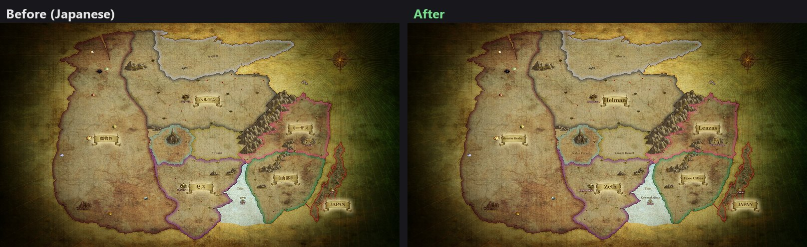
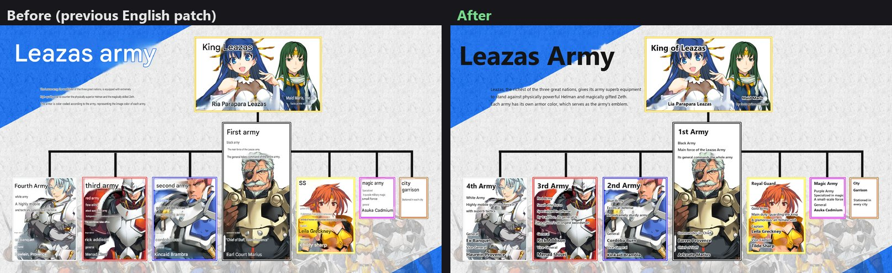

Yo, I got tired of waiting for the Rance X translation. Its been at 85% editing for like half a year now, and now they even got rid of the status on the MangaGamer page. I recently got into Claude and had it do some translations for a few Korean webnovels and I was quite happy with the translations it made, better than the ones I found by official translators, at least in quality and writing style. So I wondered if it could do Rance X well enough, this is my attempt at it.

This repo is pretty much made off of the translation already done by https://github.com/klesun/rance-10-gpt-mtl. I very much want to do a full revision of this translation in the future, since it feels quite flat, but it'd cost like 100-200$ in tokens so I am on the fence about it right now. 

The main work here is that Claude was able to pre-emptively do a ton of OCR, so the game map and some other image based text is translated. Now, I haven't tested this all yet completely, just a few preliminary tests, I am going to start to the play the game now to see what happens. I am especially worried since I got it to translate the in-game calender, but those values affect the actual gameplay as well which is why the translations before didn't touch them. I asked Claude "Hey, find a work around, make no mistakes" (Not the actual message but you get the point), however I haven't tested it myself yet, will get around to it while I play for a bit.

My hope is that anyone who wants to continue the work starts here and can save some tokens or usage. I haven't ever interacted with the fan translation community as a whole so I don't really know what to expect after posting this, not really bothered to advertise this in a forum. Feel free to send me an email if you have some eThe people who find this would probably be using Claude anyways.

If someone actually uses this, and finds a problem please create a github issue. I'll try get around to it. 

THE FOLLOWING TEXT IS COMPLETELY AI GENERATED BY CLAUDE

# Rance X English Revision

An improvement patch for the fan English translation of **Rance X -Showdown-** (AliceSoft, game version **1.04**).
It builds on klesun's [rance-10-gpt-mtl](https://github.com/klesun/rance-10-gpt-mtl) English patch and fixes and
extends it: translated images and maps, corrected names and terms, interface text, and a reviewed pass over the most
error-prone story lines.

## Before and after

**The world map from the opening** - untranslated in the previous patch:

**A Nunuhara memo (Leazas Army)** - the previous English version had wrong names ("Ria", "childy sharp"), General and
Vice-General swapped on every card, and unreadable text; this one is retranslated from the Japanese:

## What it changes

**Images (re-lettered from the Japanese originals)**
- All 40 Nunuhara memos and the 12 help screens, retranslated from the Japanese (the earlier versions were OCR +
  machine translation with many wrong names, swapped labels and unreadable text).
- 69 story maps: the world map in the opening and its variants, all regional and Monster Realm maps, and the campaign
  map overlays with commander name tags.
- About 50 more interface images: war-status maps (Monster Army), occupied-country stamps, Unit Bonus / Unit Rank,
  Interrupt Chance, EXP labels, ending-credit names, the Synopsis Mode / collection screens from the game's later
  update archives, and more.

**Interface and data**
- Around 1,400 interface and script strings that were still Japanese (speaker names, choices, battle logs, dialogs).
- Data tables: CG gallery and BGM titles, place names, achievements, all 4,414 character profile lines.
- Card names now show in English on item cards too, and long names fit their name plates.
- Smaller message-window font so translated lines fit.

**Story text**
- About 6,800 suspect lines reviewed against the Japanese: shifted or empty lines, mistranslations, wrong speakers.
- Dialogue quote marks follow the Japanese 「」 throughout (~40,000 lines).
- Character names and terms made consistent with the [AliceSoft Wiki](https://alicesoft.miraheze.org), and a bug in
  the old patch that turned "Sushinu" into "Sushinu the Gandhinu" (and similar) fixed.

The rest of the story text is still the original machine translation, so it can read flat in places.

## Installation guide

You need: the Japanese PC version of Rance X installed on Windows, and about 2 GB of free disk space while
installing. It takes about 10 minutes, most of it downloading.

### Step 1 - Find your game folder
The default location is `C:\Program Files (x86)\AliceSoft\ランス１０` (the last folder name is "Rance 10" in
Japanese). It's the folder that contains `Rance10.exe`. If you installed the game elsewhere, use that folder in the
steps below.

### Step 2 - Update the game to version 1.04
Open `Version.txt` in the game folder. If it says `1.04`, skip to Step 3. Otherwise download and run the official
update from AliceSoft: <https://www.alicesoft.com/support/rance10.html> (Japanese page; look for the ランス１０
update program), then check `Version.txt` again.

### Step 3 - Install klesun's English patch 1.04.20 (three files)
This patch builds on klesun's translation, so install that first.
1. Download these three files from klesun's release page
   (<https://github.com/klesun/rance-10-gpt-mtl/releases/tag/1.04.20>, under "Assets"):
   [`Rance10.ain`](https://github.com/klesun/rance-10-gpt-mtl/releases/download/1.04.20/Rance10.ain),
   [`Rance10EX.ex`](https://github.com/klesun/rance-10-gpt-mtl/releases/download/1.04.20/Rance10EX.ex),
   [`Rance10Pact.afa`](https://github.com/klesun/rance-10-gpt-mtl/releases/download/1.04.20/Rance10Pact.afa).
2. Copy all three into the game folder and choose **Replace the files in the destination**. If Windows asks for
   administrator permission, click **Continue**.

klesun's release page also offers optional `Rance10Flat.afa` / `Rance10CG2.afa` downloads (Google Drive). You can
skip them: this patch already includes those images and more, and works whether you installed them or not.

### Step 4 - Download this patch
Download [`Rance10-English-Revision-v1.0.0.zip`](https://github.com/NarwalThonesun/rance10-english-revision/releases/download/v1.0.0/Rance10-English-Revision-v1.0.0.zip)
(505 MB) from the [Releases](https://github.com/NarwalThonesun/rance10-english-revision/releases) page. Right-click
the zip, choose **Extract All...**, and extract it anywhere (for example your Downloads folder). Don't run anything
from inside the zip without extracting it first.

### Step 5 - Run the installer
1. Close the game if it's running.
2. Open the extracted `Rance10-English-Revision-v1.0.0` folder and double-click **`Install.bat`**.
3. Windows may show a security warning because the file came from the internet: click **More info → Run anyway**
   (or **Run**). When Windows asks whether to allow changes (administrator rights to write to Program Files), click
   **Yes**.
4. A window shows the progress. It checks every game file first (about a minute), backs up your current files,
   patches them and verifies the result. Wait for **"All done"**, then press Enter.

That's it - start the game. Existing saves keep working and show the new text.

### If something goes wrong
- **"Nothing was changed, because: ... is a version this patch does not know"** - usually Step 3 was skipped or a
  file is from a different klesun version. Redo Step 3 with the 1.04.20 files and run `Install.bat` again. Nothing
  was modified, so it's safe to retry.
- **"This patch needs game version 1.04"** - do Step 2.
- **"Could not find Rance10.exe"** - run `Install.bat` again and pick your game folder when it asks.
- **"Please close the game first"** - close Rance X and run it again.
- **Running it twice is safe**: already-patched files are recognised and skipped.

### Uninstall
Run **`Restore.bat`** from the same folder. It copies back the files saved in `_EnglishRevision_backup` inside the
game folder (your klesun-patched files from before). You can delete that backup folder once you're happy.

## Credits
- **klesun** and the contributors to [rance-10-gpt-mtl](https://github.com/klesun/rance-10-gpt-mtl) - the English
  translation this patch builds on, and its translated images.
- **nunuhara** - [alice-tools](https://github.com/nunuhara/alice-tools), used to unpack and rebuild the game files.
- The [AliceSoft Wiki](https://alicesoft.miraheze.org) - reference for character names and terms.
- [xdelta3](https://github.com/jmacd/xdelta-gpl) (Joshua MacDonald, GPL-2.0) - bundled in the release to apply the patches.
- **AliceSoft** - Rance X. This is an unofficial fan project, not affiliated with or endorsed by AliceSoft.

This revision was made with AI assistance (Anthropic's Claude): changes were checked against the Japanese text, but
mistakes are possible. Reports are welcome in [Issues](../../issues) (no spoilers in titles, please).

## License
The installer scripts and documentation in this repository are MIT-licensed (see `LICENSE`). The game, its text and
its art belong to AliceSoft; the base translation belongs to its authors.
