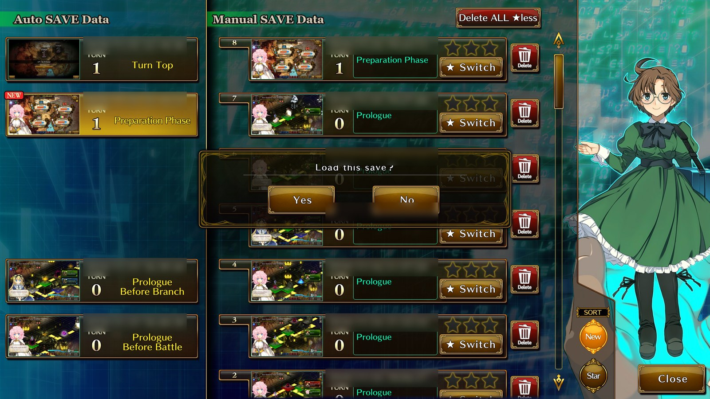
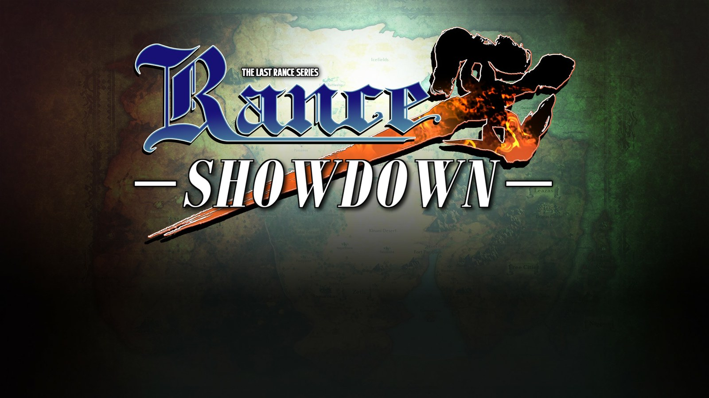
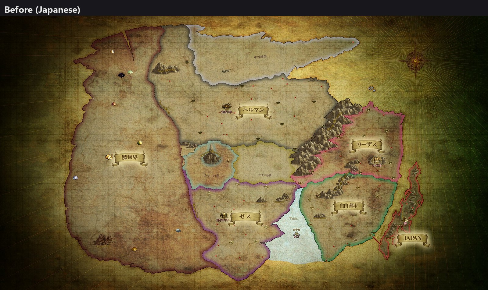
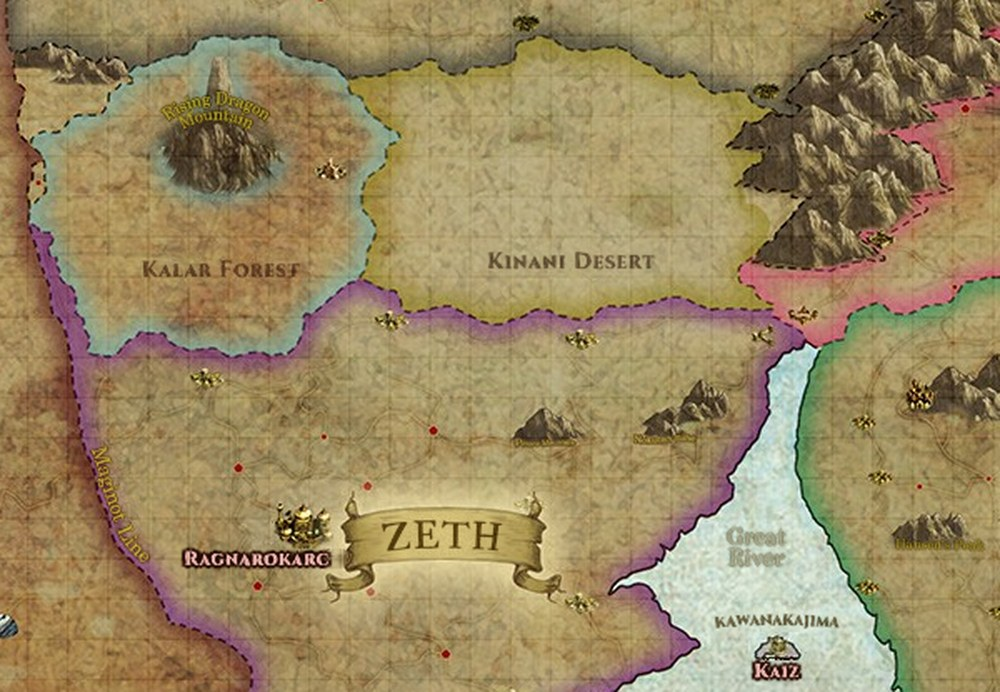
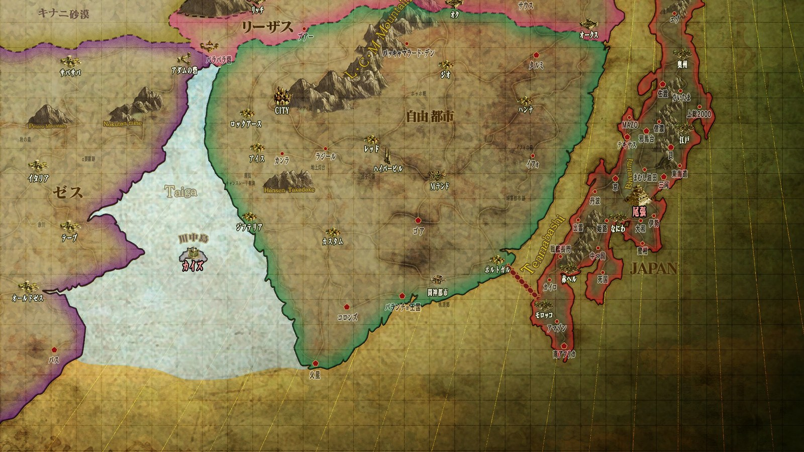
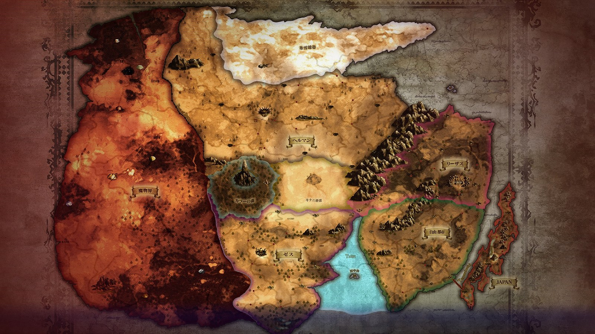
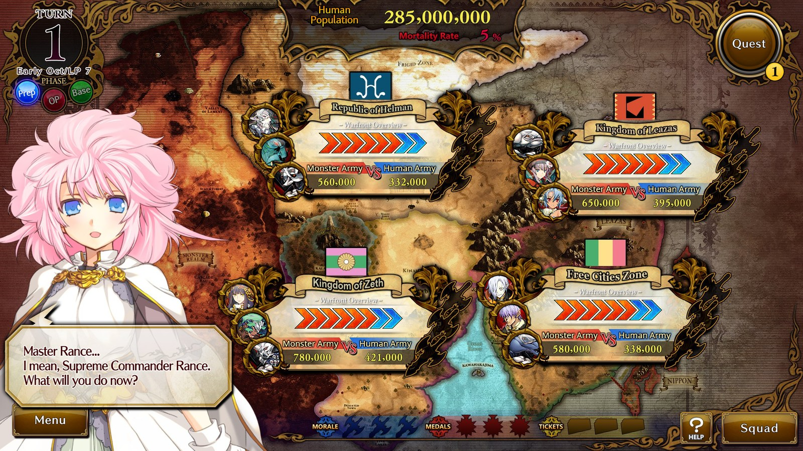
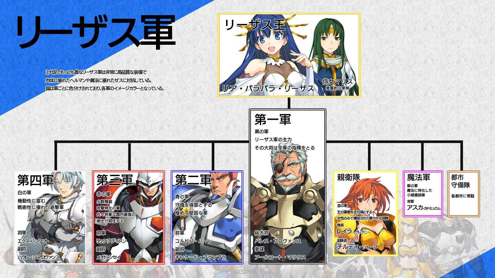
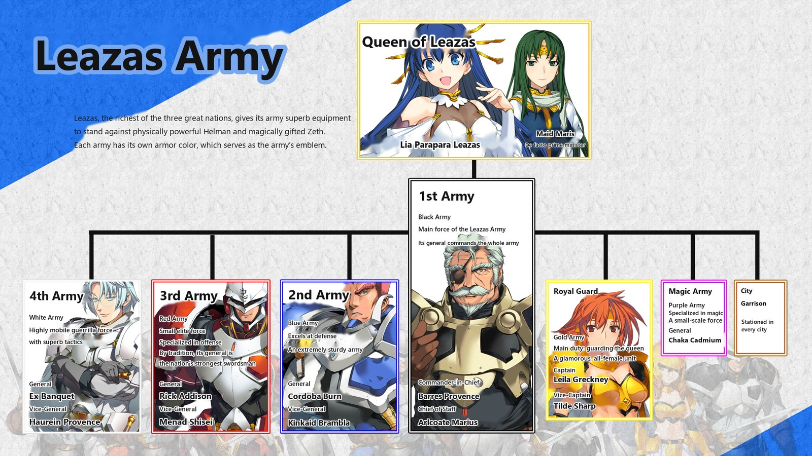

# Image comparisons

Text that is drawn into the game's images (maps, memos, help screens, logos, buttons) was re-lettered by hand
from the Japanese originals: the Japanese is removed, the background repaired, and English set in a matching font,
size and colour. Names and terms follow the [AliceSoft Wiki](https://alicesoft.miraheze.org) and the story text.
The Japanese original is always shown first. Click any image for full size. Everything shown here is interface or map art from the start of the game.

- [In the game](#in-the-game)
- [Title screen](#title-screen)
- [Maps](#maps)
- [Nunuhara memos](#nunuhara-memos)
- [Help screens](#help-screens)
- [Interface](#interface)
- [Movies](#movies)
- [What stays in Japanese](#what-stays-in-japanese)

## In the game

Screenshots taken in the game with this patch installed (1920x1080, scaled down).

Loading a save:

## Title screen

The logo subtitle 決戦 becomes -SHOWDOWN-, and the map behind the logo is re-lettered (about 115 labels: countries,
towns, landmarks and the Monster Realm).

Japanese original:

This patch:

Close-up of the title-screen map around Leazas (brightened here; in the game it sits under the vignette):

Japanese original:

This patch:

## Maps

69 story maps were re-lettered: the world map from the opening (below, with a close-up of the Zeth region) and its
variants, every regional and Monster Realm map (one of them is at the end of this section), and the campaign maps
with their commander name tags.

Japanese original:

This patch:

Close-up of the Zeth region:

Japanese original:

This patch:

A regional map, the Free Cities and JAPAN (82 labels):

Japanese original:

This patch:

The maps on the strategy screens (turn map, War Situation panels, war-status screen, quest maps) share the story maps'
labels, with AliceSoft's own painted English re-lettered in its style. The turn map:

Japanese original:

This patch:

## Nunuhara memos

The game has 40 memos (Nunuhara's notes on each army and faction), shown as full-screen images. All of them are
translated from the Japanese, along with the memo list thumbnails.

Japanese original:

This patch:

## Help screens

All 11 help screens (battle, quests, unit bonuses, meal tickets, ...), with the game-system terms used everywhere
else in the patch.

Japanese original:

This patch:

## Interface

About 50 more interface images: war-status maps, occupied-country stamps, Unit Bonus / Unit Rank, Interrupt Chance,
EXP labels, collection tabs, ending-credit names, the animated captions ("Meanwhile", war results, "Get!", phase
titles, battle-end and war-report captions), and the comma digit groups in numbers. Where the previous fan patch had already translated an image, it was
redone when the wording or the lettering didn't match the game. For example, the war-status header:

## Movies

The typed narration of the Part 1 opening movie is in English, and its name cards and nation banners are re-lettered
with the original motion. Only the frames with text are re-encoded. The ending movie (staff roll) is still Japanese.

## What stays in Japanese

- Text painted into the scenery (shop signs, banners, writing on clothes), as in the official English releases.
- Comments in save files made before installing the patch (new saves get English comments).
