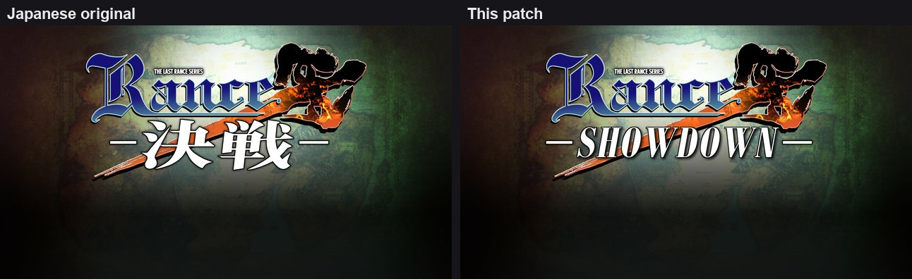
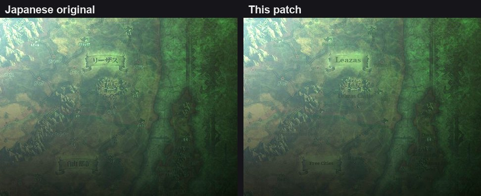
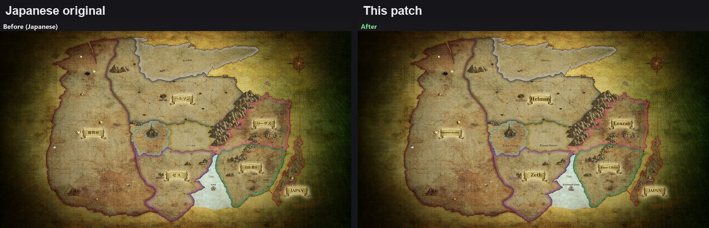
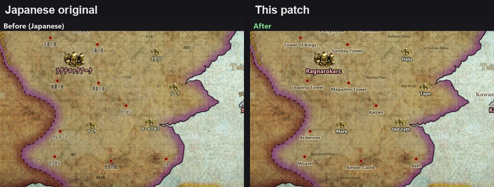
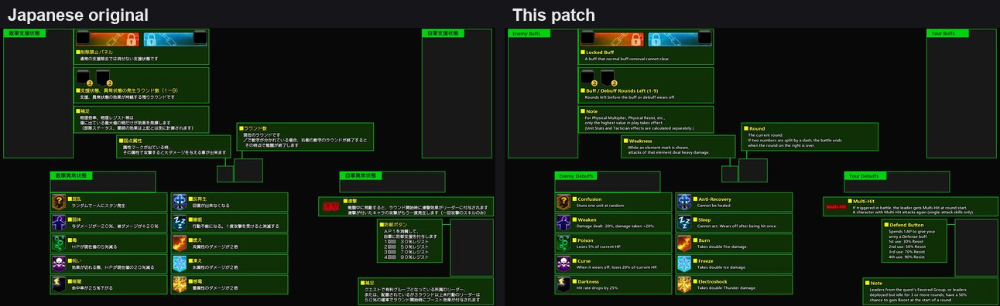

# Image comparisons

Text that is drawn into the game's images (maps, memos, help screens, logos, buttons) was re-lettered by hand
from the Japanese originals: the Japanese is removed, the background repaired, and English set in a matching font,
size and colour. Names and terms follow the [AliceSoft Wiki](https://alicesoft.miraheze.org) and the story text.
Click any image for full size. Everything shown here is interface or map art from the start of the game.

- [Title screen](#title-screen)
- [The world map](#the-world-map)
- [Nunuhara memos](#nunuhara-memos)
- [Help screens](#help-screens)
- [Interface](#interface)
- [What stays in Japanese](#what-stays-in-japanese)

## Title screen

The logo subtitle 決戦 becomes -SHOWDOWN-, and the map behind the logo is re-lettered (about 115 labels: countries,
towns, landmarks and the Monster Realm).

Close-up of the title-screen map around Leazas (brightened here; in the game it sits under the vignette):

## The world map

The world map from the opening, and a close-up of the Zeth region. 69 story maps were re-lettered: this one and its
variants, every regional and Monster Realm map, and the campaign maps with their commander name tags.

Full size: [before](images/world_map_before.jpg) / [after](images/world_map_after.jpg),
close-up [before](images/map_closeup_before.jpg) / [after](images/map_closeup_after.jpg).

## Nunuhara memos

The game has 40 memos (Nunuhara's notes on each army and faction), shown as full-screen images. All of them are
translated from the Japanese, along with the memo list thumbnails.

Full size: [before](images/leazas_memo_before.jpg) / [after](images/leazas_memo_after.jpg).

## Help screens

All 11 help screens (battle, quests, unit bonuses, meal tickets, ...), with the game-system terms used everywhere
else in the patch.

## Interface

About 50 more interface images: war-status maps, occupied-country stamps, Unit Bonus / Unit Rank, Interrupt Chance,
EXP labels, collection tabs, ending-credit names, the animated captions ("Meanwhile", war results, "Get!", phase
titles), and the comma digit groups in numbers. Where the previous fan patch had already translated an image, it was
redone when the wording or the lettering didn't match the game. For example, the war-status header:

## What stays in Japanese

- Text painted into the scenery (shop signs, banners, writing on clothes), as in the official English releases.
- Comments in save files made before installing the patch (new saves get English comments).
