# Image comparisons

Text that is drawn into the game's images (maps, memos, help screens, logos, buttons) was re-lettered by hand
from the Japanese originals: the Japanese is removed, the background repaired, and English set in a matching font,
size and colour. Names and terms follow the [AliceSoft Wiki](https://alicesoft.miraheze.org) and the story text.
The Japanese original is always shown first. Click any image for full size. Everything shown here is interface or map art from the start of the game.

- [Three versions side by side](#three-versions-side-by-side)
- [In the game](#in-the-game)
- [Title screen](#title-screen)
- [Maps](#maps)
- [Nunuhara memos](#nunuhara-memos)
- [Help screens](#help-screens)
- [Interface](#interface)
- [Movies](#movies)
- [What stays in Japanese](#what-stays-in-japanese)

## Three versions side by side

The same saves and the same clicks in three versions of the game: the official Japanese 1.04, klesun's machine
translation 1.04.20 (the previous fan patch), and this patch. Only screens where the three differ are shown (damage numbers differ because battle damage is random).

Turn map:

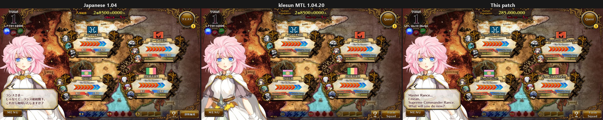

Quest map:

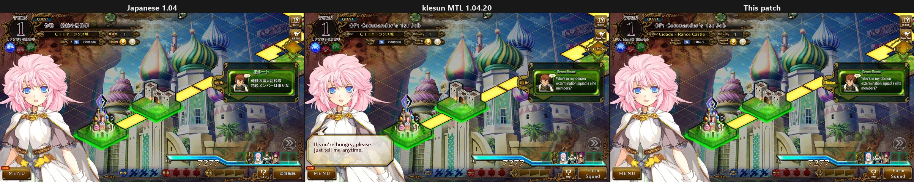

Text box (name plate, job title, quest header):

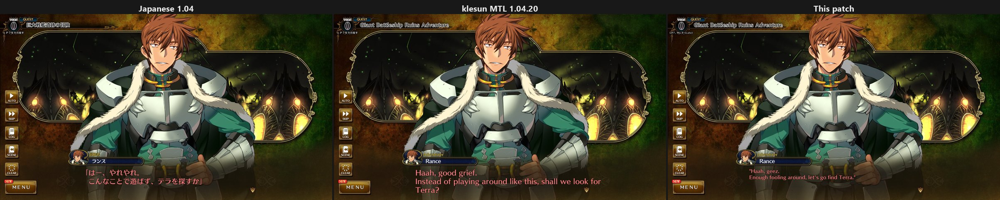

Battle: first hit and the battle log line:

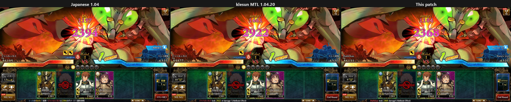

## In the game

Screenshots taken in the game (1920x1080, scaled down): the official Japanese 1.04 game first, then the same
screen with this patch. All from the opening of the game. More in-game screens: [Three versions side by side](#three-versions-side-by-side).

Battle preparation (enemy unit name and count, route table, card skills):

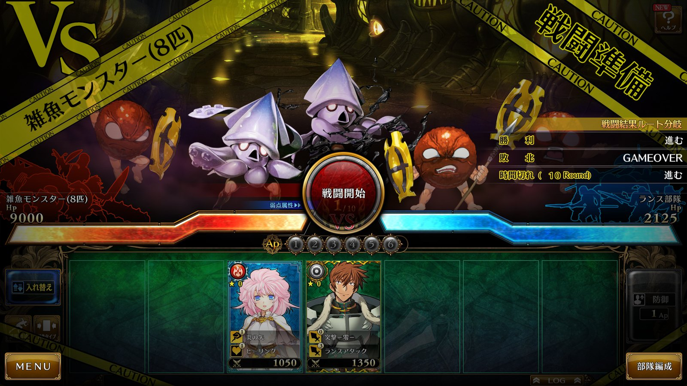

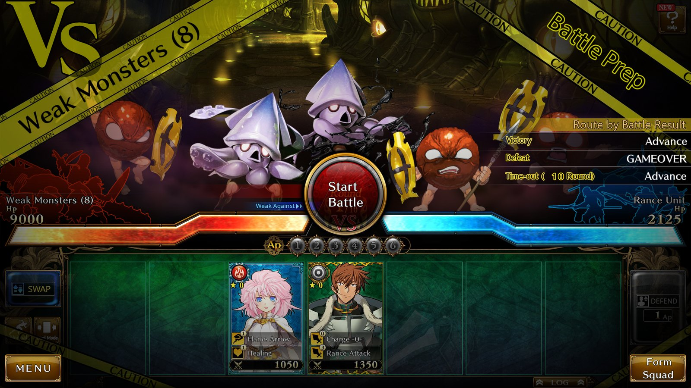

Loading a save (this patch):

## Title screen

The logo subtitle 決戦 becomes -SHOWDOWN-, and the map behind the logo is re-lettered (about 115 labels: countries,
towns, landmarks and the Monster Realm).

Japanese original:

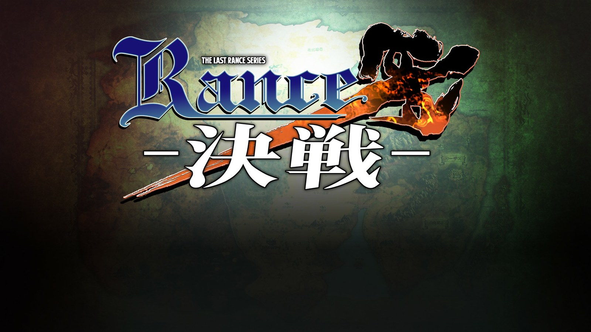

This patch:

Close-up of the title-screen map around Leazas (brightened here; in the game it sits under the vignette):

Japanese original:

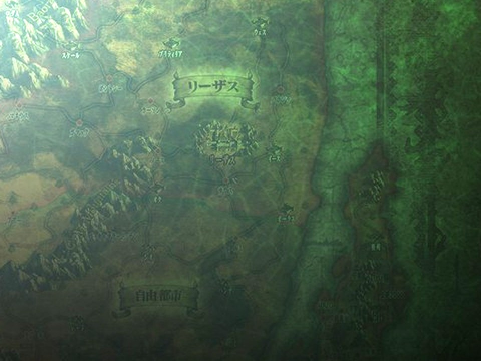

This patch:

## Maps

69 story maps were re-lettered: the world map from the opening (below, with a close-up of the Zeth region) and its
variants, every regional and Monster Realm map (one of them is at the end of this section), and the campaign maps
with their commander name tags.

Japanese original:

This patch:

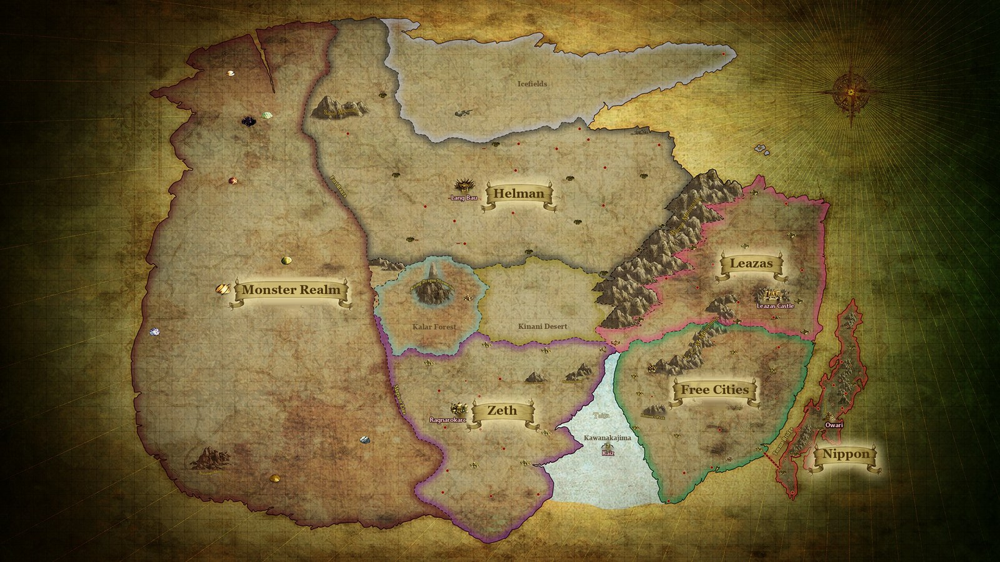

Close-up of the Zeth region:

Japanese original:

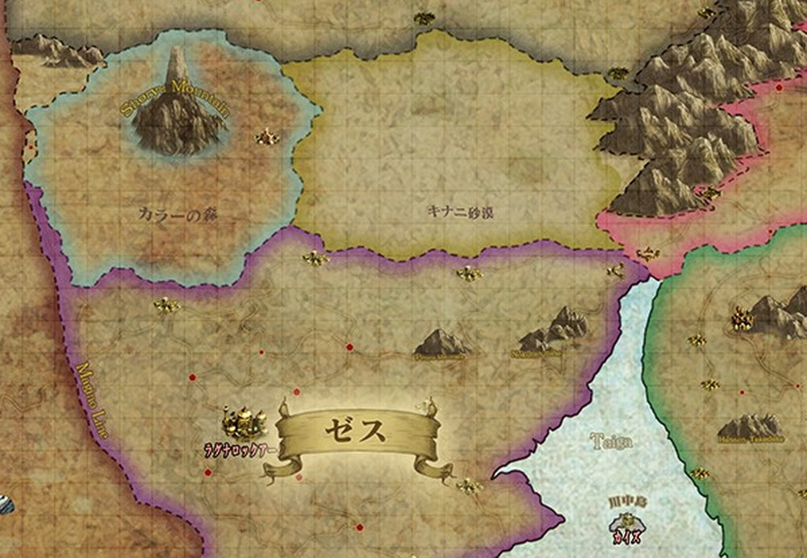

This patch:

A regional map, the Free Cities and Nippon (82 labels):

Japanese original:

This patch:

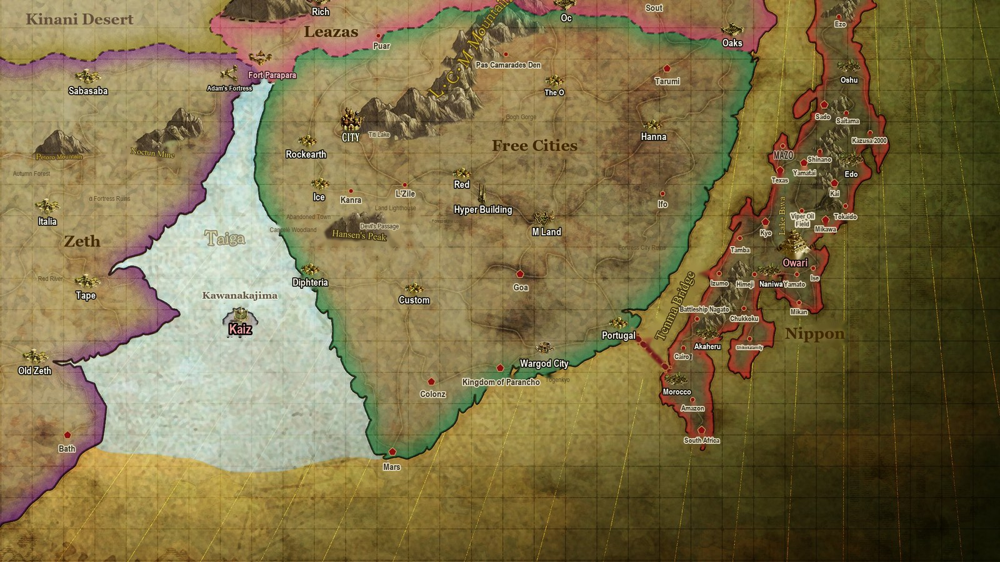

The maps on the strategy screens (turn map, War Situation panels, war-status screen, quest maps) share the story maps'
labels, with AliceSoft's own painted English re-lettered in its style (see the turn map in
[Three versions side by side](#three-versions-side-by-side)).

## Nunuhara memos

The game has 40 memos (Nunuhara's notes on each army and faction), shown as full-screen images. All of them are
translated from the Japanese, along with the memo list thumbnails.

Japanese original:

This patch:

## Help screens

All 11 help screens (battle, quests, unit bonuses, meal tickets, ...), with the game-system terms used everywhere
else in the patch.

Japanese original:

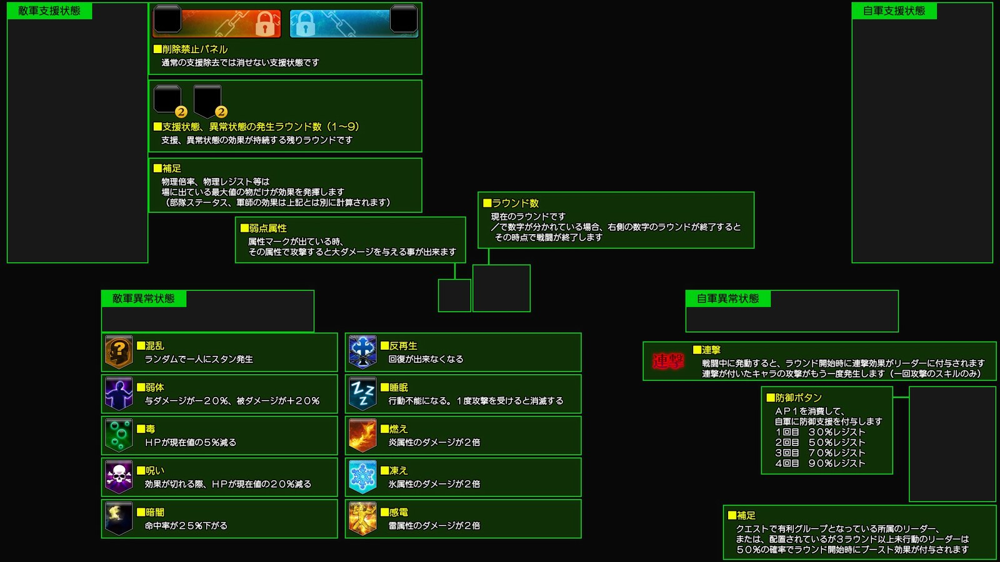

This patch:

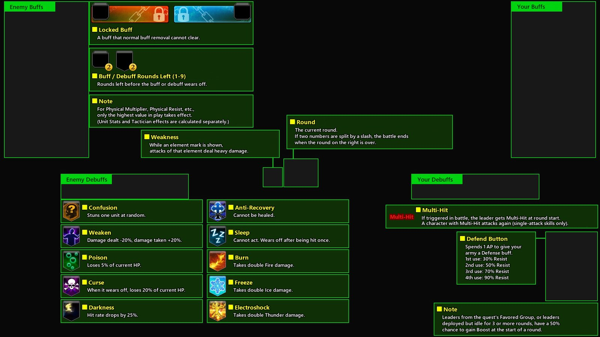

## Interface

About 50 more interface images: war-status maps, occupied-country stamps, Unit Bonus / Unit Rank, Interrupt Chance,
EXP labels, collection tabs, ending-credit names, the animated captions ("Meanwhile", war results, "Get!", phase
titles, battle-end and war-report captions), and the comma digit groups in numbers. Where the previous fan patch had already translated an image, it was
redone when the wording or the lettering didn't match the game. For example, the war-status header:

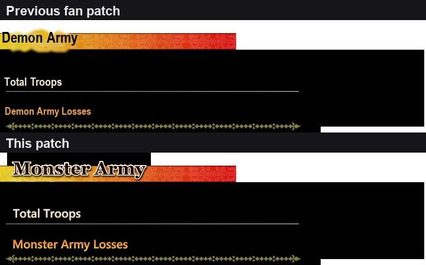

## Movies

The typed narration of the Part 1 opening movie is in English, and its name cards and nation banners are re-lettered
with the original motion: the lettering takes its outline, glow, bevel and texture from the Japanese on the same card,
and the Japanese is removed without afterimages. The title logo at the end reads -SHOWDOWN-. Only the frames with text
are re-encoded. The ending movie (staff roll) is still Japanese.

Short clips taken straight from the movie files: each plays the Japanese original first, then the same stretch from
this patch (with the original sound). The previews below are small and low frame rate; click one (or the link) for
the MP4 (720p).

Typed narration, first movie:

[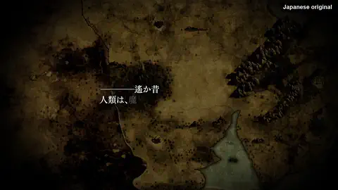](videos/narration_OP1A.mp4)
[narration_OP1A.mp4](videos/narration_OP1A.mp4) (26 s, 5.9 MB)

Typed narration, second movie:

[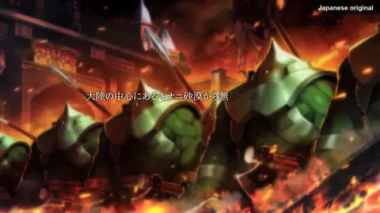](videos/narration_OP1B.mp4)
[narration_OP1B.mp4](videos/narration_OP1B.mp4) (26 s, 8.2 MB)

Nation banners and name tags, third movie:

[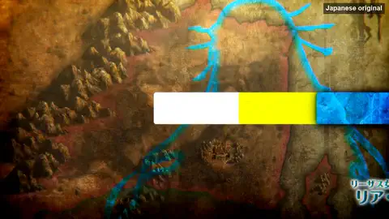](videos/banners_OP1C.mp4)
[banners_OP1C.mp4](videos/banners_OP1C.mp4) (17 s, 14.3 MB)

Name cards, third movie:

[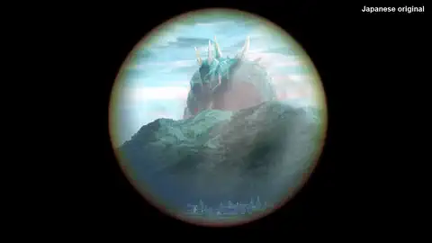](videos/cards_OP1C.mp4)
[cards_OP1C.mp4](videos/cards_OP1C.mp4) (22 s, 14.0 MB)

Title logo at the end of the third movie:

[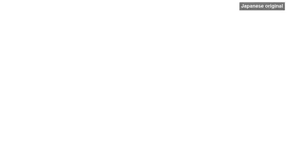](videos/logo_OP1C.mp4)
[logo_OP1C.mp4](videos/logo_OP1C.mp4) (9 s, 4.4 MB)

## What stays in Japanese

- Text painted into the scenery (shop signs, banners, writing on clothes), as in the official English releases.
- Comments in save files made before installing the patch (new saves get English comments).
